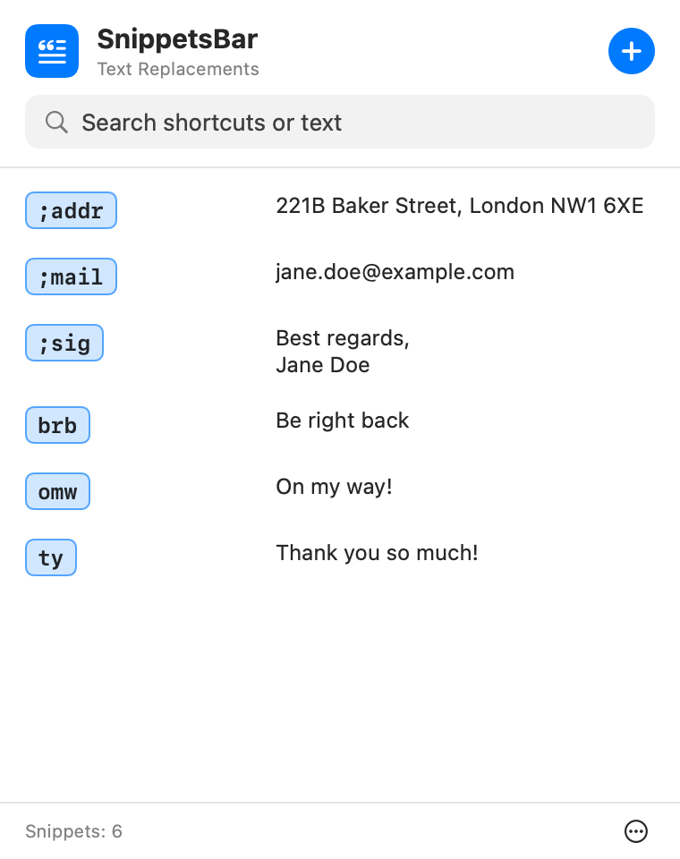
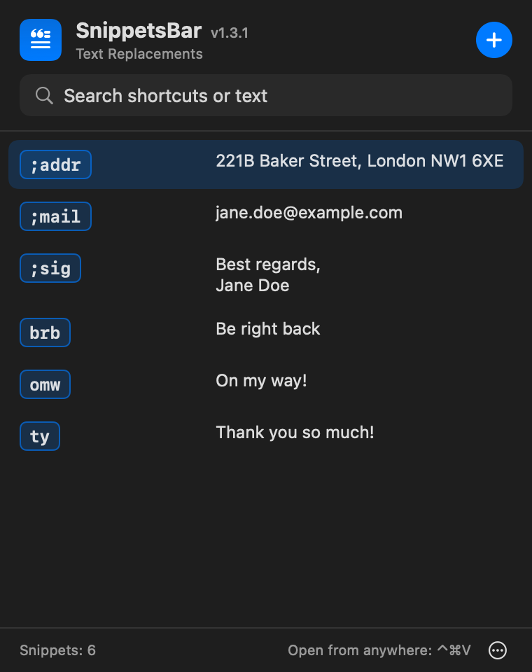
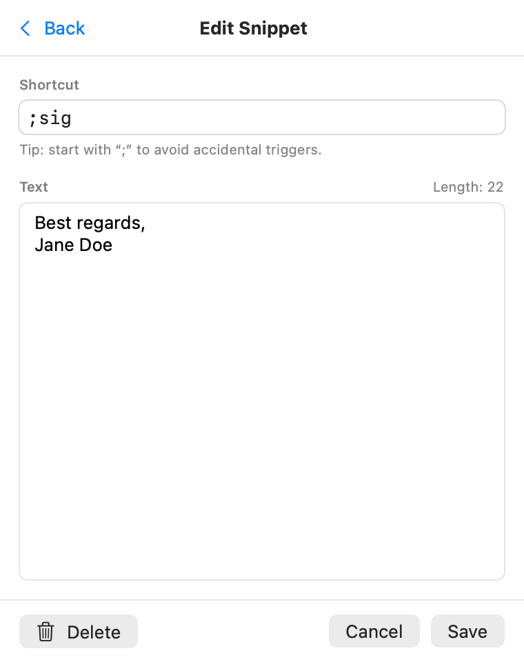
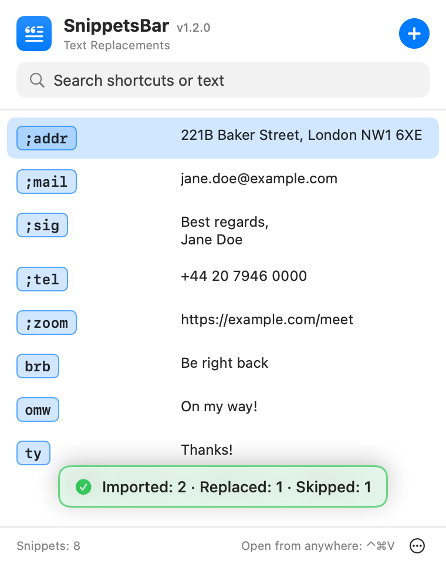

# SnippetsBar

Manage **macOS Text Replacements** from the menu bar: a simple, free and open-source
alternative to aText and TextExpander for everyday snippets.

[](https://github.com/giboow/SnippetsBar/releases/latest)
[](#installation)
[](LICENSE)

### [⬇ Download the latest version](https://github.com/giboow/SnippetsBar/releases/latest)

Free, universal app (Apple Silicon and Intel). See [Installation](#installation) for the
one-time Gatekeeper step.

- Instant list and search of all your snippets
- Click to copy the text, double-click to edit
- **Quick pick from anywhere: ⌃⌘V** opens the list, type to filter, ↑ ↓ to select,
  ↩ to copy, then paste with ⌘V (handy in terminals, where Text Replacements don’t work).
  The shortcut can be changed in **Settings** (⋯ › Settings…, ⌘,)
- Add (⌘N), edit, delete
- Duplicate shortcut detection
- Automatic database backup before the first change
- `.plist` export and import (same format as System Settings): on import, exact
  duplicates are skipped and a single question is asked for existing shortcuts with a
  different text (replace or keep)
- Settings window (⌘,): launch at login, the quick pick shortcut, version and update check
- Right-click the menu bar icon for quick actions (export, import, settings, GitHub page, report an issue, quit)

Requires macOS 13 (Ventura) or later.

## Screenshots

| Snippets list | Dark mode |
|---|---|
|  |  |
| **Editing a snippet** | **Importing a .plist** |
|  |  |

## Why SnippetsBar?

I was looking for a **simple, free and open-source alternative to aText** and other
text expanders for Mac, such as TextExpander, Typinator, TypeIt4Me, Rocket Typist,
Espanso, or the snippet features of Alfred and Raycast.

Most of them run their own expansion engine, which means another app watching your
keyboard, often a paid license or a subscription, and snippets that stay on the Mac.
macOS already has a built-in text expander, **Text Replacements**, which works in
every app and syncs through iCloud to your iPhone and iPad. It is just tedious to
manage from System Settings.

SnippetsBar is only a quick front end for that built-in feature, from the menu bar:

- no expansion engine, no keyboard monitoring: macOS does the expansion;
- your snippets sync to your other Apple devices through iCloud;
- free, open source (GPL v3), no account, no subscription.

What it does **not** do: variables, fill-in fields, scripts or rich text. If you need
those, the tools above are a better fit.

## Languages

English, French, Spanish, Italian, German, Portuguese (Brazil), Japanese and
Chinese (Simplified). The app follows the macOS language and falls back to English.

Translations live in `Localization/<language>.lproj/Localizable.strings`, with the
English text as the key. Corrections and new languages are welcome: `swift test`
checks that every language has all the keys and the same placeholders (`%@`, `%lld`).

## Installation

### From Releases

1. [Download the latest `SnippetsBar-vX.Y.Z.zip`](https://github.com/giboow/SnippetsBar/releases/latest),
   unzip it and move `SnippetsBar.app` to `/Applications`.
2. The app is not signed by an identified Apple developer, so macOS refuses to open it
   the first time. Go to **System Settings › Privacy & Security** and click
   **Open Anyway** at the bottom of the page.
   Or, in Terminal:
   ```bash
   xattr -d com.apple.quarantine /Applications/SnippetsBar.app
   ```

### From source

```bash
git clone https://github.com/giboow/SnippetsBar.git && cd SnippetsBar
./build-app.sh
mv SnippetsBar.app /Applications/
open /Applications/SnippetsBar.app
```

(Requires Xcode or at least the Command Line Tools: `xcode-select --install`.)
An app built on your own Mac is not quarantined, so there is no Gatekeeper step.

To develop: `open Package.swift` in Xcode, or `swift run`. Tests: `swift test`.
A bare `swift run` binary has no translations and shows the English UI: copy
`Localization/*.lproj` next to the built executable (or use `./build-app.sh`) to test
other languages.

### Publishing a release

```bash
git tag v1.0.0 && git push origin v1.0.0
```

The GitHub Actions workflow runs the tests, builds the app (Apple Silicon + Intel)
and publishes the `.zip` in a release.

### Full Disk Access

The database lives in `~/Library/KeyboardServices/TextReplacements.db`.
If the app shows an error when opening it, add SnippetsBar to
**System Settings › Privacy & Security › Full Disk Access**
(a button in the app takes you there), then click **Retry**.

**After an update**, macOS treats the new version as a different app (ad hoc
signature): remove SnippetsBar from the list with the “–” button, then add it again.

Launch at login is enabled on first launch (macOS shows “Background Items Added”).
To turn it off: **⋯ › Settings… › Launch at Login**, or System Settings › General › Login Items.

## Updates

SnippetsBar checks GitHub at most once a day for a newer release. When one is available,
the panel footer and the right-click menu show **Update available**, and
**Settings › About** offers a **Download** button that opens the release page. The
current version is shown next to the app name in the panel, in **Settings › About** and at
the top of the right-click menu.

Only the request to the GitHub API is sent, with no personal data. Turn it off with
**Settings › About › Check for Updates Automatically**.

## Where it works

Expansion is done by macOS itself, not by SnippetsBar, so it works wherever macOS Text
Replacements work: apps using the standard macOS text fields, such as Mail, Notes,
Messages, TextEdit, Pages or Safari.

It does **not** work in apps that handle text input themselves, notably terminals
(Terminal, iTerm2, Warp, the VS Code terminal) and often code editors, Electron apps
or some web fields in Chrome and Firefox. This is a macOS limitation.

Workaround: click a snippet in SnippetsBar to copy its text, then paste it with ⌘V.

## How it works

Apple provides no public API for text replacements. SnippetsBar reads and writes
the SQLite (Core Data) database used by macOS directly:

- **Add / edit**: the entry is flagged `ZNEEDSSAVETOCLOUD = 1` so that iCloud sync
  pushes it to your other devices.
- **Delete**: “soft” delete (`ZWASDELETED = 1`), as macOS does, so that the deletion
  syncs too.
- **Before the first write** of each session, a copy of the database is saved to
  `~/Library/Application Support/SnippetsBar/Backups/`.
- **After every change** (and at launch), the list is also copied to the global
  preference `NSUserDictionaryReplacementItems`, which apps such as Mail actually read:
  macOS does not refresh it when the database is modified directly.

⚠️ Since this is an undocumented internal format:

- apps read the list when they launch: quit and reopen an app (⌘Q) to see a new or
  changed snippet there; System Settings may only show changes after logging out;
- a future macOS version may change the format. If something goes wrong, restore a
  backup, or use **⋯ › Export as .plist…** and drag the file into
  System Settings › Keyboard › Text Replacements (the fully official method).

## License

Copyright © 2026 Philippe Gibert

SnippetsBar is free software distributed under the [GNU GPL v3](LICENSE): you can
redistribute and modify it under the terms of this license. It comes with no warranty.
